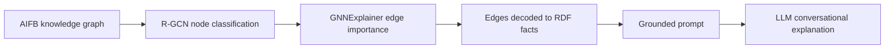

# Graph-LLM-Explainer

Grounded conversational explanations for graph neural network predictions: an R-GCN classifies researchers in the AIFB knowledge graph, GNNExplainer finds the edges behind each prediction, and a language model explains the prediction in dialogue using only those edges as evidence.

## Problem

Graph neural networks classify nodes accurately but their decisions are hard to inspect. GNNExplainer returns the influential edges as a numeric mask, which is not readable for a non-expert. A language model can turn that evidence into a conversation, but it will happily add plausible facts that the model never used. This project constrains the language model to the extracted explanation, so every statement in an answer can be traced back to an edge the R-GCN relied on.

## Pipeline



1. **R-GCN on AIFB** predicts the research group of each labelled researcher (`notebooks/02_rgcn_model.ipynb`).
2. **GNNExplainer** ranks the edges that influenced a single prediction.
3. **Edges to RDF facts** decodes edge types back to predicates and restores the original edge direction (`src/graph_llm_explainer/facts.py`).
4. **Grounded prompt** passes the prediction metadata and the ranked facts to the language model together with rules that forbid invented facts (`src/graph_llm_explainer/prompts.py`).
5. **Conversational explanation** is generated with Gemini 2.5 Flash for six fixed questions and rated manually (`notebooks/03_conversational_explanations.ipynb`).

## Results

### Node classification

The R-GCN reaches a test accuracy of **0.944** (34 of 36 test nodes) and a train accuracy of 0.986. Macro F1 is 0.89, weighted F1 is 0.94. The smallest class has only 3 test nodes, so class-wise numbers are noisy.

### Explanation fidelity

For the 34 correctly classified test nodes, edges were removed from the graph and the drop in confidence for the predicted class was recorded (mean over nodes; random removal is repeated 5 times per node).

| Removed edges | Top explanation edges | Random edges | Least important edges |
|---|---|---|---|
| 1 | 0.011 | 0.000 | 0.000 |
| 3 | 0.106 | 0.000 | 0.000 |
| 5 | 0.186 | 0.000 | 0.000 |
| 10 | 0.276 | 0.000 | 0.000 |

Removing the ten top edges changes the predicted class for 32% of the nodes; removing random or least important edges never does.

### Quality of the conversational explanations

Six explained nodes were each asked six questions (36 answers) and rated manually with binary scores by one evaluator. The per-answer ratings are in `results/conversations/llm_evaluation_*.csv`.

| Criterion | Score |
|---|---|
| Grounded in the evidence | 100.0% |
| Useful for understanding the prediction | 100.0% |
| Free of hallucinated facts | 100.0% |
| Handles uncertainty explicitly | 61.1% |
| Mean of the four criteria | 90.3% |

These numbers describe a small proof of concept: 6 nodes, one rater, and no inter-rater agreement. The classification result rests on a test set of only 36 nodes. See [Limitations](#limitations) for a caveat about the evidence behind the rated answers.

### Example conversation

Node: *Yu Li*, predicted and true class *Business Information and Communication Systems*. Each answer is generated independently from the same evidence (excerpt from `results/conversations/conversation_node_5672.json`).

> **Q:** Is this evidence strong enough to trust the prediction?
>
> **A:** Yes, the evidence is strong enough to trust the prediction. The explanation shows that Yu Li is an author of several publications, including "Ein Framework zur Modellierung und Analyse von XML-Netzen", "Simulation von Supply Chains mit Petri-Netzen", and "Prozessorientierte Komposition von Diensten in der Doktorandenausbildung". The predicted class, "Business Information and Communication Systems", is directly linked to publishing these same works. This establishes a clear connection between Yu Li's research output and the predicted class.

> **Q:** Can you summarize the explanation in one sentence?
>
> **A:** The prediction is primarily supported by Yu Li authoring publications like "Ein Framework zur Modellierung und Analyse von XML-Netzen" and "Simulation von Supply Chains mit Petri-Netzen," which are also published by "Business Information and Communication Systems."

## Setup and usage

```bash
python -m venv .venv
source .venv/bin/activate          # macOS/Linux
pip install -r requirements.txt    # also installs the local package in editable mode
```

If the environment does not appear in Jupyter, register a kernel with `python -m ipykernel install --user --name graph-llm-explainer`.

| Notebook | Needs an API key | Purpose |
|---|---|---|
| `01_data_exploration.ipynb` | No | Explores the AIFB graph and the label splits |
| `02_rgcn_model.ipynb` | No | Trains the R-GCN, runs GNNExplainer, evaluates fidelity (needs `torch` and `torch-geometric`) |
| `03_conversational_explanations.ipynb` | For the LLM step | Decodes explanations to facts, builds prompts, generates and evaluates conversations |

Run the notebooks in order from the `notebooks/` directory. Notebook 02 writes a checkpoint to `artifacts/` (ignored by git) and explanations to `results/explanations/`.

**Notebook 03 without a key.** Set `USE_LLM = False` and run sections 1 to 6 to inspect the decoded evidence and the grounded prompt, then section 10 to aggregate the saved evaluation files. Sections 7 to 9 call the API and overwrite the files in `results/conversations/`, so skip them unless that is intended.

**Notebook 03 with a key.** Copy `.env.example` to `.env` and set `GEMINI_API_KEY`. Requests are sent to the Gemini API and are billed according to the account's plan. `.env` is ignored by git.

**Tests.** The fact decoding and prompt construction are covered by tests that need neither data nor a key:

```bash
pip install -e ".[dev]"
pytest
```

## Repository layout

| Path | Content |
|---|---|
| `src/graph_llm_explainer/` | Relation vocabulary, edge-to-fact decoding (`facts.py`), grounded prompt (`prompts.py`) |
| `tests/` | Unit tests on a small synthetic graph |
| `notebooks/` | Data exploration, R-GCN and GNNExplainer, conversational explanations |
| `results/explanations/` | GNNExplainer edges for the 34 correctly classified test nodes |
| `results/conversations/` | Evidence, generated conversations and manual ratings for six nodes |
| `data/raw/` | AIFB graph and label splits |
| `report/` | Project report (PDF) |

## Report

The report [`report/XAI_Mini_Project_Report.pdf`](report/XAI_Mini_Project_Report.pdf), *From Graph Explanations to Conversational XAI: Grounding LLM Responses with GNNExplainer*, is included as written. Its fidelity table comes from an earlier run than the notebook outputs in this repository, so the values differ slightly, and it predates the decoding fix described below.

## Data

The graph in `data/raw/` is the AIFB dataset (`aifbfixed_complete.n3`) with the label and split files `completeDataset.tsv`, `trainingSet.tsv` and `testSet.tsv`: 29,226 triples, 8,285 nodes, 176 labelled researchers in four research groups, 36 of them in the test split.

The dataset keeps its own terms; the MIT licence of this repository covers the code only. The benchmark overview of the University of Mannheim Data and Web Science group lists AIFB under CC BY, and the original source page names no licence, so the terms should be checked with the sources below before redistributing the data. Please cite:

- Bloehdorn, S., Sure, Y.: Kernel Methods for Mining Instance Data in Ontologies. In: The Semantic Web, ISWC/ASWC 2007, LNCS 4825, pp. 58-71. Springer (2007).
- Ristoski, P., de Vries, G. K. D., Paulheim, H.: A Collection of Benchmark Datasets for Systematic Evaluations of Machine Learning on the Semantic Web. In: ISWC 2016. https://doi.org/10.1007/978-3-319-46547-0_20

## Limitations

- **Mislabelled predicates in the saved conversations.** The saved conversations were generated with a decoding error: the notebook rebuilt the relation vocabulary without excluding `swrc:member` and `swrc:employs`, which the trained model had excluded, so edge types above a certain index decoded to the wrong predicate. This mislabelled the predicate of 20 of the 60 evidence facts (for example a fax number shown as `:homepage`). The code is fixed and covered by a test, but the files in `results/conversations/` are kept unchanged as the recorded run, because regenerating them requires new API calls. The manual evaluation scores therefore reflect partly mislabelled evidence and should be read with that caveat.
- **Small evaluation.** The test split has 36 nodes, the conversational evaluation covers 6 nodes and 36 answers with a single evaluator and binary scores.
- **Simple model inputs.** Node features are one-hot encoded degrees only; no text or attribute features are used.
- **Fidelity measure.** Fidelity is the confidence drop after removing edges from the full graph for correctly classified nodes only; no other explainers are compared.
- **Single dataset and model.** Results are for AIFB and one R-GCN configuration; generation uses one language model at temperature 0.2 and is not guaranteed to be reproducible.

## Licence

The code is released under the [MIT licence](LICENSE). The report PDF is included as written, and the AIFB data keeps its own terms (see [Data](#data)).
